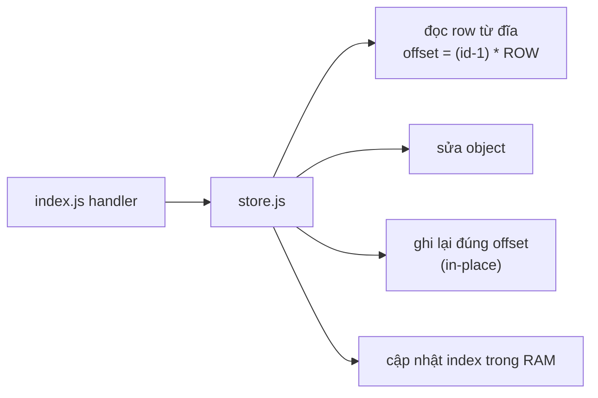

# Hướng dẫn đọc `src/store.js`

Tài liệu này giải thích `store.js` hoạt động thế nào, từng khối code làm gì và
vì sao. Mục tiêu: đọc xong hiểu được cách một datastore tự viết (không DB engine)
lưu và truy xuất dữ liệu.

## 1. Ý tưởng cốt lõi

`store.js` là lớp dữ liệu của app. Nó **không dùng database engine** — tự đọc/ghi
file CSV. Điểm khác biệt so với CSV thường: **mỗi row dài cố định (fixed-length)**.

- Mỗi row được đệm cho đủ một số byte cố định (`USERS_ROW = 340`, `TASKS_ROW = 180`).
- Vị trí row thứ `index` là `index * ROW` byte → tìm row bằng **phép nhân**, không
  cần quét dấu `\n`.
- Sửa/xoá một row = **ghi đè đúng chỗ đó** (in-place). Không sinh rác, không cần
  compaction.
- RAM chỉ giữ **index nhỏ** (email → id, token → id, task theo user). Data row nằm
  trên đĩa, đọc theo nhu cầu.
- `id = slot + 1`; xoá = đánh dấu `free`/`alive=0`, **slot không được tái sử dụng**
  nên id không bao giờ trùng.



## 2. Quy đổi id, slot và offset

Ba khái niệm, đừng lẫn:

- **slot**: thứ tự vật lý của row trong file, **đếm từ 0**. Dùng để tính offset.
- **id**: định danh logic đưa ra API, **đếm từ 1**.
- **offset**: vị trí byte của row.

```
slot   = id - 1
offset = slot * ROW = (id - 1) * ROW
```

Ví dụ với `TASKS_ROW = 180`:

| id | slot | offset | byte |
|----|------|--------|------|
| 1 | 0 | 0 | 0–179 |
| 2 | 1 | 180 | 180–359 |
| 3 | 2 | 360 | 360–539 |

Vì sao id bắt đầu từ 1? Để `0`/`''`/`null` đều mang nghĩa "chưa gán" (ví dụ
`user_id` rỗng). Nếu id bắt đầu từ 0 thì `0` là falsy trong JS, dễ lẫn "id hợp lệ"
với "không có id".

## 3. Khối comment đầu file (dòng 1–9)

Hợp đồng thiết kế của cả file: không DB engine, row dài cố định, RAM chỉ giữ index,
xoá = đánh dấu `free`. `'use strict'` bật chế độ nghiêm ngặt để bắt lỗi sớm.

## 4. Thư viện & đường dẫn (dòng 11–16)

```js
const fs = require('fs');
const path = require('path');
const DATA_DIR = process.env.DATA_DIR || path.join(__dirname, '..', 'data');
const USERS_FILE = path.join(DATA_DIR, 'users.csv');
const TASKS_FILE = path.join(DATA_DIR, 'tasks.csv');
```

`DATA_DIR` cho ghi đè qua biến môi trường (test/migration dùng). Dùng `__dirname`
chứ không phải `process.cwd()` để đường dẫn đúng dù chạy từ đâu.

## 5. Layout row (dòng 18–40)

Mỗi phần tử là `[tên field, độ rộng tính bằng BYTE]`. Thứ tự field = thứ tự trong file.

```js
const USERS_LAYOUT = [
  ['email', 64], ['password_hash', 128], ['salt', 32], ['status', 8],
  ['verify_token', 64], ['verify_expires', 13], ['created_at', 24]
];
const TASKS_LAYOUT = [
  ['title', 128], ['alive', 1], ['done', 1], ['user_id', 10],
  ['created_by', 10], ['created_at', 24]
];
const rowSize = (layout) => layout.reduce((n, [, width]) => n + width + 1, 0);
const USERS_ROW = rowSize(USERS_LAYOUT); // 340
const TASKS_ROW = rowSize(TASKS_LAYOUT); // 180
```

`rowSize` = tổng độ rộng + 1 byte dấu phân cách mỗi field. Giới hạn là **byte**,
không phải ký tự: tiếng Việt có dấu tốn 2–3 byte/ký tự.

`MAX_EMAIL_BYTES`/`MAX_TITLE_BYTES` lấy trực tiếp từ layout → đổi width là giới hạn
tự đổi theo. `index.js` dùng để trả `400` khi input quá dài.

## 6. Định vị cột `status` để tối ưu (dòng 42–51)

Trong một row, cột `status` chiếm byte cố định (off 227, dài 8 byte). IIFE dưới đây
tự tính offset đó từ layout (không hardcode):

```js
const STATUS_FIELD = (() => {
  let off = 0;
  for (const [name, width] of USERS_LAYOUT) {
    if (name === 'status') return { off, len: width };
    off += width + 1;
  }
})(); // → { off: 227, len: 8 }
const FREE_CELL = Buffer.from('free'.padEnd(STATUS_FIELD.len, ' '));
```

Vì sao bọc `(() => {...})()`? Vì ở cấp module không dùng được `return`, phải nhét
vào hàm rồi gọi ngay (IIFE).

`FREE_CELL` là 8 byte của giá trị row chết: `"free    "` (4 chữ + 4 dấu cách đệm).
Phải khớp **cả padding** vì `encodeRow` đệm mọi cell bằng dấu cách cho đủ width.

Nhờ hai thứ này, `listUsers` biết row sống/chết bằng cách **so 8 byte** thay vì
decode cả row — đây là chỗ tối ưu chính (xem mục 11).

## 7. Codec row (dòng 57–80)

```js
function encodeRow(layout, data) { /* ... đệm space, nối bằng ',' ... */ }
function decodeRow(layout, buf) { /* ... cắt theo byte, trim space ... */ }
```

- `encodeRow`: mỗi field → `utf8` → nếu vượt `width` thì **ném lỗi** (chốt an toàn)
  → đệm space → nối bằng `,`, field cuối bằng `\n`.
- `decodeRow`: cắt theo **byte position** (`pos += width + 1`), **không `split(',')`**
  → giá trị chứa dấu phẩy hay `\n` vẫn đọc đúng.

## 8. Mở file (dòng 82–91)

```js
function openFile(file) {
  fs.mkdirSync(path.dirname(file), { recursive: true });
  if (!fs.existsSync(file)) fs.writeFileSync(file, '');
  return fs.openSync(file, 'r+'); // đọc + ghi, ghi đè tại chỗ
}
const usersFd = openFile(USERS_FILE);
const tasksFd = openFile(TASKS_FILE);
```

`'r+'` mở để đọc **và ghi tại vị trí bất kỳ** (không truncate). Hai file descriptor
giữ suốt vòng đời process.

## 9. Đọc/ghi row (dòng 93–101)

```js
function readRow(fd, layout, size, index) {
  const buf = Buffer.alloc(size);
  const n = fs.readSync(fd, buf, 0, size, index * size);
  return n === size ? decodeRow(layout, buf) : null; // short read → qua EOF
}
function writeRow(fd, layout, size, index, data) {
  fs.writeSync(fd, encodeRow(layout, data), 0, size, index * size);
}
```

`index` = slot (0-based), `index * size` = offset. Đây là nơi `offset = (id-1)*ROW`
được thực thi. `writeRow` ghi đè nếu slot tồn tại, append nếu vượt EOF.

## 10. Index RAM (dòng 103–118)

```js
const emailToId = new Map();       // email -> id
const tokenToId = new Map();       // verify token -> id
const tasksByUser = new Map();     // user được giao -> Set(taskId)
const tasksCreatedBy = new Map();  // author -> Set(taskId)
```

Hai index `tasks*` cần **cả hai** vì một task có 2 quan hệ: được giao cho ai
(`user_id`) và do ai tạo (`created_by`).

Các biến đếm/con trỏ: `userCount`/`taskCount` (row sống), `usersSlots`/`tasksSlots`
(row vật lý kể cả `free`), `nextUserId`/`nextTaskId`.

## 11. Load & dựng index (dòng 120–176)

`loadUsers()`/`loadTasks()` chạy **ngay khi module được nạp**. Chúng đọc theo block
512 row (một syscall cho 512 row), decode từng row, và chỉ nạp **index** — row vẫn ở đĩa.

- users: bỏ `status === 'free'`; nạp `emailToId` + `tokenToId`.
- tasks: bỏ `alive !== '1'`; nạp `tasksByUser` + `tasksCreatedBy`.

Kết thúc: `usersSlots = base`, `nextUserId = base + 1` — đây chính là chỗ `id = slot + 1`.

## 12. Nhóm hàm users (dòng 180–286)

Mẫu chung: `getUserById` (đọc row từ đĩa) → sửa object → `putUser` (ghi lại đúng
slot) + cập nhật index.

| Hàm | Việc |
|-----|------|
| `getUserById` | id → slot, kiểm tra biên, đọc row, loại row `free` |
| `getUserByEmail` | tra `emailToId` (O(1)) rồi mới đọc đĩa |
| `createUser` | cấp id, status `pending`, ghi đĩa + set index |
| `activateUser` | chuyển `active`, dọn token (index + đĩa) |
| `setVerifyToken` | đổi token: xoá token cũ khỏi index, set token mới |
| `setPasswordHash` | cập nhật hash + salt |
| `deleteUser` | dọn index, đánh dấu `status='free'`, ghi đè |

`listUsers(limit, offset)`: đọc block 512 row; với mỗi row **so 8 byte `status` với
`FREE_CELL`** để bỏ row chết **mà không decode**; chỉ decode row vào trang. `skip`
chỉ đếm row sống để phân trang đúng. Kết quả trên file 1,000,003 row:
`listUsers(50, 999950)` từ **3614ms → 100ms**.

`countUsers`/`countUserTasks`/`countTasksCreatedBy` đếm O(1) nhờ index, dùng để
chặn xoá user còn task.

## 13. Nhóm hàm tasks (dòng 330–457)

Cùng mẫu với users, khác điều kiện sống là `alive === '1'`.

| Hàm | Việc |
|-----|------|
| `findTaskById` | đọc row theo id, `null` nếu `alive !== '1'` |
| `listTasks` | quét tuần tự toàn file (task board dùng chung) |
| `listUserTasks` | lấy id từ `tasksByUser`, sort, đọc từng task |
| `createTask` | ghi đĩa + cập nhật **cả 2** index |
| `updateTask` | đổi `user_id` thì gỡ index cũ → thêm index mới |
| `assignTask` | luôn gỡ chủ cũ → gán chủ mới |
| `deleteTask` | dọn cả 2 index, ghi `alive='0'` |

**Điểm dễ sai:** mọi thay đổi `user_id`/`created_by` phải đi kèm gỡ index cũ và
thêm index mới. Nếu quên, task sẽ mồ côi (không tìm thấy qua index).

## 14. Bền vững (dòng 459–486)

- Ghi là **synchronous** (`writeSync`) một row nhỏ → nằm ở OS cache khi hàm trả về.
- `flush()` = `fsyncSync` cả 2 fd để đẩy xuống đĩa thật (sống sót khi mất điện).
- Tự động `flush` khi process `exit` và khi `SIGINT`/`SIGTERM`.
- `close()` đóng fd — cần cho test/script phải xoá data dir (Windows khoá file đang mở).

## 15. Export (dòng 488–521)

Chỉ lộ những gì tầng khác cần. `readRow`/`writeRow`/`decodeRow`/`putUser`/`putTask`
và các `index*` **không export** — đó là chi tiết nội bộ.

## 16. Bốn ý cốt lõi (để nắm vấn đáp)

1. **Row dài cố định** → `offset = (id-1) * ROW`, truy cập O(1), sửa in-place,
   không compaction.
2. **RAM chỉ giữ index**, data đọc từ đĩa theo nhu cầu.
3. **Xoá = đánh dấu** `free`/`alive='0'`, slot không tái dùng → id ổn định.
4. **Đổi quan hệ phải cập nhật index**, và ghi synchronous + fsync để bền vững.
